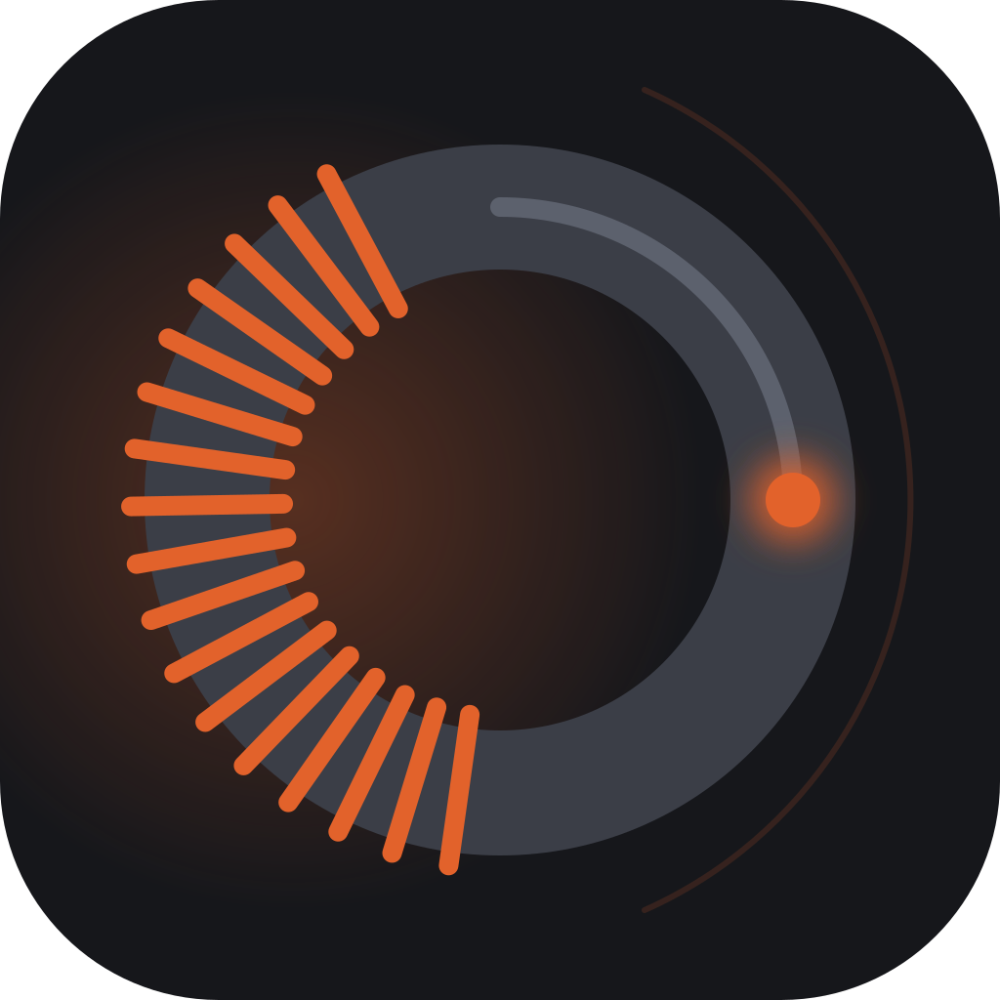
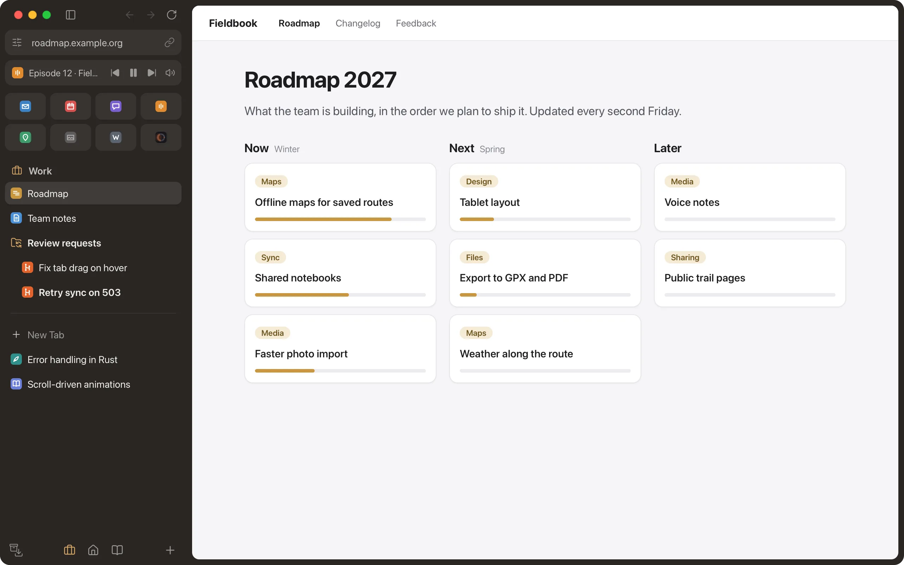

<p align="center">
  
</p>

<h1 align="center">Magnetite</h1>

<p align="center">
  A fast, open-source browser built around a sidebar.<br>
  No telemetry, no account.
</p>

<p align="center">
  <a href="https://magnetitebrowser.org">Website</a> ·
  <a href="#what-it-does">Features</a> ·
  <a href="#private-by-default">Privacy</a> ·
  <a href="#status">Status</a> ·
  <a href="#build-it-yourself">Build</a> ·
  <a href="#documentation">Documentation</a>
</p>

<p align="center">
  
</p>

Vertical tabs, spaces, a command bar, split view, and tabs that archive themselves. Magnetite runs on the Chromium engine, so websites and Chrome extensions work as you know them. Sync between your devices is optional and end-to-end encrypted, through Magnetite's free server or one you host yourself.

Magnetite started as a new home for the workflow of the Arc browser and has grown into a product of its own. It is an independent project: not affiliated with, endorsed by or sponsored by The Browser Company, and without any of its code, assets or branding.

## What it does

### The sidebar

- **Spaces.** Keep work, private life and side projects apart, each with its own icon, colour, pinned tabs and tabs of the day.
- **Favorites.** The sites you open every day as a grid of icons at the top, the same in every space.
- **Pinned tabs and folders.** Pinned tabs stay where you put them and return to their page; folders keep them in order.
- **Today tabs.** Everything else you open. It leaves by itself when you stop using it.
- **Bookmarks.** Addresses to keep without keeping a tab, in folders, per space. One view shows the bookmarks of all spaces.
- **Out of the way.** `Cmd+S` hides the sidebar; at the window's left edge it slides out over the page.

### Getting around

- **Command bar.** `Cmd+T` opens one field for addresses, searches, open tabs, bookmarks, history, the archive and commands. A keyword searches one site: `gh rust`.
- **Split view.** Up to four pages side by side, with dividers you can drag.
- **Peek.** `Shift`+click opens a link over the page. Close it, or keep it as a tab with `Cmd+O`.
- **Mini windows.** `Cmd+Option+N` searches from any app and opens the result in a small window; links from other apps can open there too. One click moves it into a space.
- **Clean links.** `Cmd+Shift+C` copies the address without tracking parameters.

### Tabs that look after themselves

- **Close means archive.** A closed tab goes to the archive, where you can search it and bring it back. `Cmd+Shift+T` reopens the last one.
- **History on your terms.** Visited pages stay on this computer for 7, 30 or 90 days, or not at all; never synced, nothing from private logins.
- **Auto-archive.** Today tabs you have not used for 12 hours are archived; you choose the time.
- **Unloading.** Tabs hidden for 4 hours give their memory back and reload when you return. Favorites and tabs you mark "Keep active" stay loaded.

### Logins kept apart

- **Shared, separate or private, per space.** A space can use your main logins, its own, or logins that are forgotten when you quit.
- **Two accounts of one site.** A favorite can have logins of its own, next to the same site with another account.
- **Site controls.** Permissions, zoom, and "clear cookies and storage" for one site, behind the address row.

### Sync, if you want it

- **End-to-end encrypted.** A 24-word code is the only key. The server stores data it cannot read.
- **No account.** No email, no password. Use Magnetite's free server, or [run your own](https://github.com/magnetite-browser/magnetite-sync).
- **Your choice per space.** A space can stay on one device, such as work on the work computer.

### The web as you know it

- **Chrome extensions** from the Chrome Web Store, with pinned ones in the sidebar.
- **Chromium's own tools.** Find in page, the PDF viewer, and DevTools docked beside or below the page.
- **Passwords and autofill.** Saved passwords, addresses and cards, filled in for you and kept on your computer.
- **Media controls** in the sidebar for whatever plays in another tab, and picture-in-picture with its own controls.
- **Capture.** A screenshot of an element, a region, the visible part or the whole page.
- **Smart folders.** Your review requests and issues from GitHub, GitLab, Jira or YouTrack as tabs that keep themselves current.

### Moving in

- **A first start that asks.** Magnetite reads nothing from another browser and opens no site until you say so.
- **Import** spaces, tabs, tab groups and bookmarks from Arc, Chromium-based browsers, Firefox and Zen, and bookmarks from Safari or any exported bookmarks file. Passwords, cookies and history are never read.

## Status

Magnetite is developed and used daily on macOS (Apple silicon). Linux builds start and pass the tests. Windows has not been built yet.

There are no releases yet, so for now you [build it yourself](#build-it-yourself). Expect breaking changes, including to the data format on disk.

Not there yet: several main windows, and H.264 or AAC playback on Linux and Intel Macs (the standard build of the engine comes without these codecs, so some video and music sites do not play; on Macs with Apple silicon, Magnetite uses [its own build](https://github.com/magnetite-browser/magnetite-cef) with them). Every spec in [`docs/spec/`](docs/spec/README.md) ends with what its feature still lacks.

## Install

Releases will appear on the GitHub releases page, one package per system:

- **macOS 13 or newer** (Apple silicon, Intel): a zip with `Magnetite.app`, also through Homebrew.
- **Linux** (x86_64, aarch64): an rpm (Fedora, RHEL) and a deb (Debian, Ubuntu), which update with your system's updates, and a tarball for other systems; its `README.md` explains the sandbox setup.

Magnetite updates itself from these releases. The update list is signed, and `SHA256SUMS` lists the packages' checksums.

## Private by default

No telemetry, no analytics, no account. Magnetite talks to:

- the sites you open,
- the services you connect yourself: sync and smart folders,
- GitHub, to check for updates once there are releases,
- Google's component server, from which Chromium fetches the Widevine module for protected video and its certificate lists.

Two things that rely on Google's services are left out for that reason: page translation and Safe Browsing warnings.

Sync is end-to-end encrypted, and the search engine is yours to choose. What Magnetite's own code guards on top of Chromium's protections, and what the engine contacts on its own, is written down in [`docs/design/security.md`](docs/design/security.md).

## Build it yourself

```sh
git clone https://github.com/magnetite-browser/magnetite.git
cd magnetite
scripts/build.sh              # the sidebar UI and the app, packaged into dist/
```

You need [Rust](https://rustup.rs), CMake, Ninja, Node 22 and pnpm 10. The first build downloads the Chromium Embedded Framework, 350 MB and more. The steps for each system, development builds and the tests are in [`docs/development/building.md`](docs/development/building.md).

## Documentation

- [Feature specs](docs/spec/README.md), how each feature behaves and what it still lacks
- [Architecture](docs/architecture.md) and the [decisions](docs/adr/) behind it
- [Security rules](docs/design/security.md) of Magnetite's own code
- [Building and testing](docs/development/building.md)
- [Releases](docs/development/release.md), how they are made and signed
- [Licence compatibility](docs/legal/license-compatibility.md), how third-party code fits with the EUPL

## Contributing

Bug reports, ideas and pull requests are welcome. [CONTRIBUTING.md](CONTRIBUTING.md) has the ground rules and the checks to run (there is no CLA), and everyone taking part follows the [code of conduct](CODE_OF_CONDUCT.md). To report a security issue, see [SECURITY.md](SECURITY.md).

## License

Magnetite is licensed under the [European Union Public Licence v1.2](LICENSE)
(EUPL-1.2). You may use, study, change and share it. If you distribute
Magnetite or a modified version, you must offer the source code under the
EUPL-1.2, as a copy or a link to where it is freely available. Official texts exist in every
EU language: <https://interoperable-europe.ec.europa.eu/collection/eupl/eupl-text-eupl-12>.
Why we chose it: [ADR-0006](docs/adr/0006-license.md).

Third-party components keep their own licences. The Rust crates, npm packages
and CEF, with their full licence texts, are in
[THIRD_PARTY_NOTICES.md](THIRD_PARTY_NOTICES.md). Chromium's components are
listed in CEF's `CREDITS.html`, which ships with every app build (also at
`chrome://credits`). How it all fits with the EUPL, and what each package
must contain: [docs/legal/license-compatibility.md](docs/legal/license-compatibility.md).

Contributions are accepted under the EUPL-1.2 (inbound = outbound): you license
your contribution under the same terms as the project, see
[CONTRIBUTING.md](CONTRIBUTING.md).

```
Copyright © 2026 the Magnetite contributors
Licensed under the EUPL
```

## Name and logo

The licence covers the code and the image files. It does not give the right
to use the name "Magnetite" or its logo for something else (EUPL-1.2, Art. 5).
They are the marks of the project, held by StackForge UG (haftungsbeschränkt),
the company that publishes Magnetite.

- If you distribute a changed version, give it another name and logo, so
  nobody takes it for ours.
- You may always say truthfully that your work is based on Magnetite or works
  with it.
